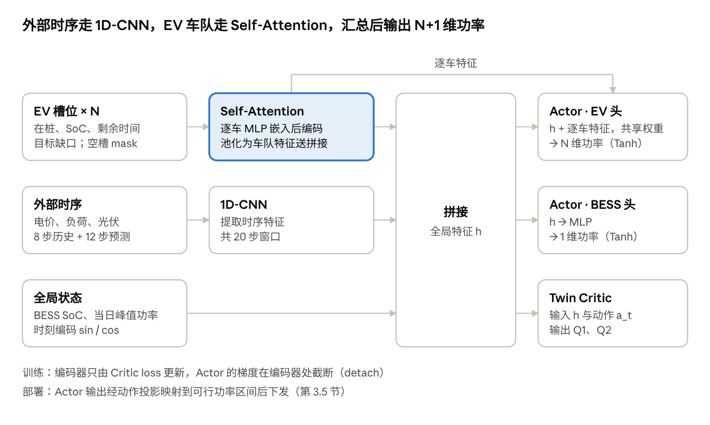

# 楼宇 V2G 混合储能调配系统 · 技术方案（定稿 v1）

> 如需改动定稿决策（第 2 节），请先在群里讨论，确定后再更新本文件。

## 1. 项目目标与系统构成

本项目用 SAC 强化学习，按 30 min 步长调度楼宇固定储能和 5–10 辆 V2G 电动汽车，目标是全天运行总成本最低，同时保证每辆 EV 离场时达到目标电量。

| 组成部分 | 在模型中的角色 | 是否由 RL 决策 |
| --- | --- | --- |
| 外部主电网 | 按时段电价买电或售电；购电功率超过合同容量时收超额容量费 | 否，由功率平衡被动决定 |
| 楼宇负荷与屋顶光伏 | 外生输入序列，光伏只覆盖部分日间负荷 | 否 |
| 固定式 LFP 储能（BESS） | 削峰填谷的主力 | 是，1 维连续功率 |
| V2G EV 车队（N = 5–10 个充电桩槽位） | 满足离场电量的前提下参与放电调峰 | 是，每个槽位 1 维连续功率 |
| 超级电容 | 只在系统描述中做定性说明：作用在秒级实时控制层（平抑波动、分担冲击电流），不进入 30 min 调度和成本核算 | 否 |

## 2. 已确定的设计决策

下表是本版定稿的全部关键决策，后续调研和开发以此为准；如需改动，请先在群里讨论。

| 项目 | 定稿 | 理由 |
| --- | --- | --- |
| 决策步长 | 30 min，一个 episode = 一天 = 48 步 | 与新加坡 USEP 半小时电价、半小时最大需量计量对齐 |
| 算法 | 只做方案一 SAC；D3QN 不做 | 动作维度 6–11，离散分档会组合爆炸；功率本身是连续量 |
| 网络结构 | 1D-CNN 编码外部时序 + Self-Attention 编码 EV 车队 | 车数可变、车与车需要协调、与排列顺序无关，正是 Attention 擅长的问题 |
| EV 建模 | 固定 N 个充电桩槽位（N = 5–10），空槽用 mask | 保留单车离场约束，便于动作投影 |
| 超级电容 | 只做定性说明 | 作用时间尺度为秒级，对 30 min 能量账贡献极小 |
| 反向送电 | 允许，上网价低于购电价 | 买卖同价时 agent 会学成反复刷差价 |
| 电价口径 | 购电价 = USEP + 固定附加费；上网价 = USEP | 有公开的真实半小时数据，附加费自然拉开买卖价差 |
| 容量费 | 月费率折算到日，按“新峰值超出部分”增量计入单步成本 | 保持马尔可夫性，Critic 能得到与动作直接相关的信号 |
| 预测值 | 真值加噪声 | 模拟真实预测误差，实现简单 |
| EV 离场约束 | 动作投影（不用惩罚项） | 硬约束只靠惩罚，RL 经常学不稳 |
| BESS 日末电量 | 日末不低于日初，写进动作投影 | 否则策略日末放空储能白拿电量，与基线比较不公平 |
| 折旧模型 | 按充放电吞吐量线性折算（S$/kWh） | 课程项目足够，参数容易调研 |
| 基线 | 无储能、规则策略、MILP 离线最优（替代原分工中的动态规划参考方案） | 证明 RL 的收益，并给出上下界 |
| 训练与测试 | 按日期 14/7/7 划分训练、验证、测试，测试再换随机种子 | 几乎零成本，避免模型只是背下训练曲线 |

## 3. MDP 形式化

每步 Δt = 0.5 h，一个 episode 为一天（48 步），每天 00:00 重置。功率一律以楼宇交流侧为参考：充电为正、放电为负。

### 3.1 状态 s_t

| 分组 | 内容 | 维度 |
| --- | --- | --- |
| 外部时序 | 电价、楼宇负荷、光伏出力；历史 8 步（4 h）+ 预测 12 步（6 h）。预测值 = 真值 × (1 + ε)，ε 为零均值高斯噪声，标准差随预测步数增大 | 3 × 20 |
| 全局状态 | BESS SoC；当日至今最大购电功率 P̂_{t−1}；时刻编码 sin / cos | 4 |
| EV 槽位 × N | 是否有车、SoC、剩余驻留步数、距离场目标电量的缺口；空槽全部填 0 | 4 × N |

### 3.2 动作 a_t

a_t = [a_bess, a_ev,1, …, a_ev,N] ∈ [−1, 1]^(N+1)，由 Actor 的 Tanh 输出。环境把每一维线性映射到该设备本步的可行功率区间 [P_lo, P_hi]（3.5 节），所以任何动作都是可行的：

```latex
P = P_{lo} + \frac{a + 1}{2}\,(P_{hi} - P_{lo})
```

空槽的功率直接置 0。每台设备只有一个带符号的功率变量，天然不会同一步既充又放。

### 3.3 功率平衡与电量更新

```latex
P^{grid}_t = P^{load}_t - P^{pv}_t + P^{bess}_t + \sum_{i=1}^{N} P^{ev}_{i,t}
```

P^grid > 0 为购电，< 0 为上网。储能和 EV 的电量按充放电效率分别更新：

```latex
E_{t+1} = E_t + \eta_{ch}\,[P_t]^{+}\,\Delta t - \frac{[P_t]^{-}}{\eta_{dis}}\,\Delta t
```

### 3.4 单步成本与 reward

```latex
C_t = \lambda^{buy}_t [P^{grid}_t]^{+}\Delta t - \lambda^{sell}_t [P^{grid}_t]^{-}\Delta t + C^{peak}_t + c_{bess}|P^{bess}_t|\Delta t + \sum_{i} c_{ev}|P^{ev}_{i,t}|\Delta t
```

reward r_t = −C_t。各项说明：

- 购电价 λ^buy = USEP + 固定附加费，上网价 λ^sell = USEP。
- 容量费按增量计，一天累加恰好等于日费率 × 当日超出合同容量的峰值：

```latex
C^{peak}_t = c^{d}_{ucc}\left[\max(0,\hat P_t - P^{cc}) - \max(0,\hat P_{t-1} - P^{cc})\right],\quad \hat P_t = \max(\hat P_{t-1}, P^{grid}_t),\quad c^{d}_{ucc} = c^{m}_{ucc}/30
```

- 折旧按吞吐量线性计：c_bess、c_ev 的单位是 S$/kWh。
- 转换损耗已经通过效率体现在多买的电里，不再单独计费，避免重复计算。
- 光伏日折旧维护费和合同容量费与决策无关，只计入总成本报表，不进 reward。

### 3.5 约束与动作投影

每步先算出每台设备的可行区间 [P_lo, P_hi]，再按 3.2 节映射。区间取以下约束的交集：

1. 额定功率：−P_dis,max ≤ P ≤ P_ch,max。
2. SoC 边界：本步结束后 E_min ≤ E_{t+1} ≤ E_max。
3. EV 离场约束：第 i 辆车还剩 k 步离场时，本步结束后的电量必须保证“之后 k − 1 步全功率充电能补到目标”：

```latex
E_{i,t+1} \ge E^{target}_i - \eta_{ch} P^{ev}_{ch,max} (k-1)\,\Delta t
```

这条下界把离场约束变成硬约束：车快走时，可行区间会自动收缩到“只能充电”。

**BESS 日末约束**：日末电量不低于日初（E_48 ≥ E_0）。否则策略会在一天结束前把储能放空，白拿约 45 kWh 电量，和无储能基线比较不公平。实现方式与 EV 离场约束相同，还剩 k 步时下界为：

```latex
E^{bess}_{t+1} \ge E^{bess}_0 - \eta_{ch} P^{bess}_{ch,max} (k-1)\,\Delta t
```

## 4. 网络架构

采用方案一 SAC：外部时序用 1D-CNN 编码，EV 车队用 Self-Attention 编码，两者与全局状态拼接后，分别送入 Actor 的 EV 头、BESS 头和 Twin Critic。



与原方案的区别：原方案把 Attention 用在时间维度，但在 20 步的短窗口上 1D-CNN 已经够用；本版把 Attention 移到 EV 维度，理由如下。

- **为什么 Attention 放在 EV 维度**：在桩车数会变化，车与车之间要协调谁先充、谁放电，而且结果与槽位顺序无关。这正是 self-attention 擅长的问题。
- **EV 头对每辆车共享权重**：参数量不随 N 增长，N = 5 和 N = 10 可以用同一个网络。
- **空槽处理**：在 Attention 里用 key padding mask 屏蔽，对应输出强制为 0，不干扰其他车。
- **可解释性**：注意力权重可以画出来，检验临近离场的车是否获得更高权重（6.4 节）。
- **编码器规模**：Attention 1–2 层、4 个 head、嵌入维度约 64，加 LayerNorm。
- **训练稳定性**：编码器只由 Critic 的 loss 更新，Actor 的梯度在编码器处截断（detach）。这是 SAC 搭配较大编码器时的常见做法，能明显减少训练发散。

## 5. 仿真环境流程

环境按 Gym 风格实现 `reset()` / `step(a)`，每步都记录各项功率和成本，便于之后画图。

1. `reset()`：按随机种子生成当天的电价、负荷、光伏序列和 EV 到达/离场计划，初始化 BESS SoC，把 P̂ 置 0。
2. 构造观测：取历史 8 步真值，给未来 12 步真值加噪声作为预测，拼上全局状态和 EV 槽位状态。
3. agent 输出动作 a_t ∈ [−1, 1]^(N+1)。
4. 动作投影：按 3.5 节算出每台设备的可行区间，把动作映射为实际功率，空槽置 0。
5. 状态更新：按效率更新 BESS 和各车电量；到离场时刻的车记录是否达标后移出，新到的车填入空槽。
6. 结算：由功率平衡得到 P^grid，更新 P̂，按 3.4 节算单步成本，返回 r_t = −C_t。
7. 第 48 步结束 episode，输出日度指标（6.2 节）。

规则策略和无储能基线也走同一个环境，可以顺便用来检验环境本身有没有写对。

## 6. 实验设计

核心问题是 SAC 策略在测试日上的日均总成本，位于“无储能”上界和“离线最优”下界之间的哪个位置。

### 6.1 基线

| 基线 | 做法 | 作用 | 是否必做 |
| --- | --- | --- | --- |
| 无储能 | BESS 不动作，EV 一到就按最大功率充满 | 成本上界 | 必做 |
| 规则策略 | 谷时充电、峰时放电，阈值写死；EV 按离场时间优先充 | 证明 RL 优于人工规则 | 必做 |
| MILP 离线最优 | 已知整天真实数据，用 CVXPY / Pyomo 直接求解 | 理论下界 | 必做（替代原动态规划参考方案） |

### 6.2 评价指标

- 日均总成本及分项：购电费、售电收入、容量费、BESS 折旧、EV 折旧。
- 日最大购电功率（削峰效果）。
- EV 离场达标率：有动作投影时应为 100%，用作环境正确性的校验。
- BESS 与 EV 的日吞吐量（用来解释折旧成本）。

### 6.3 训练与测试

D 交付的 28 天数据按日期划分：10-01 至 10-14 训练，10-15 至 10-21 验证，10-22 至 10-28 测试。车辆计划和预测噪声的随机种子训练用 0–99，测试用 100–119。所有基线和 SAC 在同一批测试日、同一批种子上对比。

### 6.4 建议的结果图

- 典型日功率曲线：负荷、光伏、BESS、EV 合计与购电功率，叠加电价。
- BESS 与各车 SoC 曲线。
- 注意力权重与剩余驻留时间的关系：看临近离场的车是否获得更高权重。
- 各策略日均总成本的分项对比。

## 7. 调研任务与交付要求

参数的具体取值由 D 确定（“背景”一行由 E 负责），但请按下表的格式交付，仿真可以直接读入。时序数据统一整理为 30 min 粒度、每天 48 个点；没有真实数据集时，给出典型日曲线和波动幅度（例如 ±10%），由仿真加噪声生成。每个参数都附上来源；采用假设值的，请注明“假设”。

> D 的交付已完成，见 `data/D/`。

### 7.1 参数清单

| 类别 | 需要交付的内容 | 单位 / 格式 |
| --- | --- | --- |
| 电价 | USEP 半小时历史数据（至少若干周）；购电附加费常数（输配电、市场费等） | S$/kWh，48 点/天 |
| 容量费 | 合同容量 P^cc；超额容量费月费率（参考 SP 高压用户费率表） | kW；S$/kW/月 |
| 楼宇负荷 | 真实数据，或典型日曲线 + 波动幅度；楼宇峰值负荷 | kW，48 点/天 |
| 屋顶光伏 | 装机容量；出力曲线；按 20 年寿命和维护折算的日成本 | kWp；kW，48 点/天；S$/天 |
| 固定储能 BESS | 容量、额定充放电功率、SoC 上下限、充放电效率、循环寿命与单价 → 吞吐折旧 | kWh、kW、%、S$/kWh |
| EV 与充电桩 | 桩数 N（5–10）、单桩最大充放电功率、车载电池容量、到达与离场时间分布、初始 SoC 范围、离场目标 SoC、车载电池吞吐折旧 | kW、kWh、时刻分布、%、S$/kWh |
| 转换效率 | 储能变流器（PCS）、V2G 双向充电机、光伏逆变器的综合效率 | 常数 |
| 超级电容 | 典型参数与作用说明，只用于报告的定性描述 | 文字 |
| 背景 | V2G 物理连接架构、现有 V2G 平台、通信标准（如 ISO 15118、OCPP） | 文字 |

### 7.2 规模匹配关系

各设备规模必须互相匹配，否则储能要么削不动峰，要么闲置，实验结果没有意义：

- 光伏峰值出力小于楼宇午间负荷，符合“只覆盖部分日间负荷”的设定。
- BESS 额定功率与“楼宇峰值负荷 − 合同容量”同一量级。
- EV 车队总放电功率与 BESS 同量级或略小，否则 V2G 只是摆设。
- 合同容量 P^cc 由 D 调研确定，需低于楼宇峰值负荷，否则削峰没有意义。

## 8. 推进顺序

调研和环境开发可以并行：环境先用占位参数写，调研结果交付后再替换，不必等。

1. **调研**：D、E 按第 7 节交付参数表、数据和背景资料。
2. **仿真环境**（与第 1 步并行）：A 按第 3–5 节实现，先用占位参数；C 同时实现无储能和规则策略两个基线，用它们检验环境。
3. **SAC 与参考方案**：B 先在 N = 5 上跑通完整架构，收敛后扩到 N = 10；C 完成 MILP 参考方案。
4. **跑实验**：F 按 6.3 节运行和检查，D 核对计算，A–C 修复问题。
5. **报告**：B 按 6.4 节出图，G 整合，超级电容部分用 E 的定性描述。

任何一项定稿决策（第 2 节）需要改动时，请先在群里讨论，确定后统一更新本文件。

## 9. 任务对接

| 人员 | 需要交给小组什么 | 具体要做什么，用直白的话说 |
| --- | --- | --- |
| A：主编程①——把储能和电动车放进电脑里模拟 | 能运行的仿真程序；每个时段的电量、充放电量和费用记录；简单的使用说明。 | 写出储能和电动车充电、放电后电量怎么变化；算买电花多少钱、卖电收入多少；限制不合理操作。公式见第 3 节，参数由 D 提供。 |
| B：主编程②——让 SAC 学会做决定 | SAC 程序；训练好的模型；训练过程记录；说明它学到了什么、哪里表现不好；能自动生成的成本、电量和充放电对比图。 | 在 A 的仿真环境里，让程序反复尝试充电、放电，根据花费学习怎样选择；网络按第 4 节搭；检查训练次数、参数变化是否影响结果；整理绘图功能。 |
| C：程序协助——做对照、接程序 | 对照方案和参考方案；统一运行方法。 | 写出“到场就充电”和“低价充电、高价放电”两种普通方案；完成 MILP 参考方案；把各方案接到同一套程序中，整理运行入口。 |
| D：模型与参数——先把怎么算、怎么设定讲清楚 | 参数表和来源；运行限制清单；手算核对案例；参考方案的计算说明。 | 确定储能和电池多大、充电多快、初始电量多少、几点离开、电价多少；为参数找依据；用小例子手算核对程序，并协助 C 确定参考方案的计算步骤。 |
| E：资料调研——研究现实中的 V2G | 系统示意图；平台与标准对比表；背景部分初稿；可靠的参考文献。 | 解释车、储能、充电桩和电网怎样连接；找约 2 个现有平台进行比较；介绍关键标准的作用；画出系统结构，整理引用。 |
| F：实验测试——多跑几种情况，检查程序靠不靠谱 | 实验计划和运行记录；不同情况下的结果表；问题清单；哪些条件下表现好或差的初步发现。 | 提前列好测试计划；按说明运行程序；改变车辆数、初始电量或离场时间；检查有没有电量越界、离场时电不够等问题；记录问题交给 A–C 修复。 |
| G：结果分析与报告整合——把结果讲明白 | 结果分析、结论与局限；精选图表及说明；整合后的报告草稿；需要各成员修改的问题清单。 | 根据 F 的结果，分析 SAC 比普通方案省了多少、离参考结果还有多远；解释结果和局限；把各人的文字合成一份连贯报告。 |

### 9.1 接口约定

各人分头做的部分按以下约定交接，最后才能直接拼在一起（仓库中的具体写法见根目录 README）：

- **D → A**：`params.yaml` 存所有常数（单位见 §7.1）；时序数据存为 CSV，每天 48 行，列为时段、电价、负荷、光伏。
- **A → B、C、F**：环境采用 Gymnasium 接口，`env = V2GEnv(params)`，`obs, info = env.reset(seed=s)`，`obs, r, terminated, truncated, info = env.step(a)`，其中 a ∈ [−1, 1]^(N+1)；`info` 里带各项实际功率、成本分项和 EV 离场达标情况。
- **A、B、C → F、G**：每次运行输出一个 CSV，每行一步，列为策略名、种子、时段、P_grid、P_bess、各车功率、各 SoC、成本分项。
- 所有策略（无储能、规则、MILP、SAC）都跑同一个环境、同一批测试种子。MILP 直接读当天真实序列求解，再把解出的功率放进环境里结算，保证计费口径一致。

### 9.2 报告篇幅

正文最多 5 页，建议只放 4 张主图：网络架构图、典型日调度曲线、各策略成本对比、注意力权重图。
